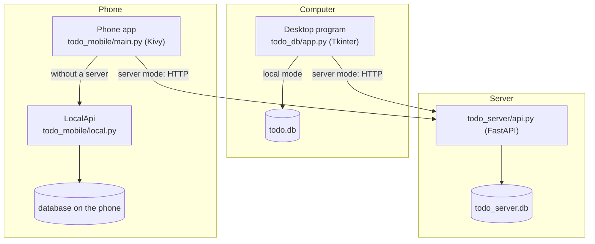
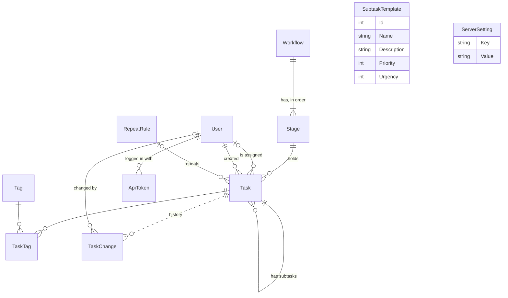
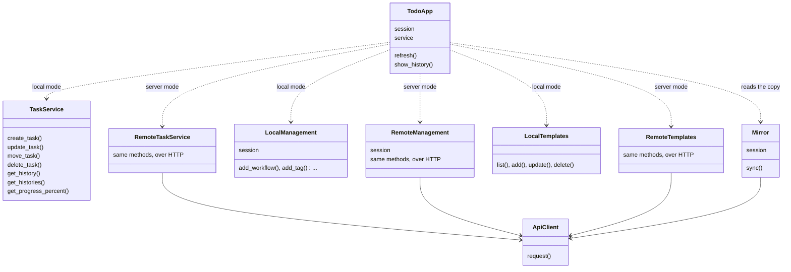
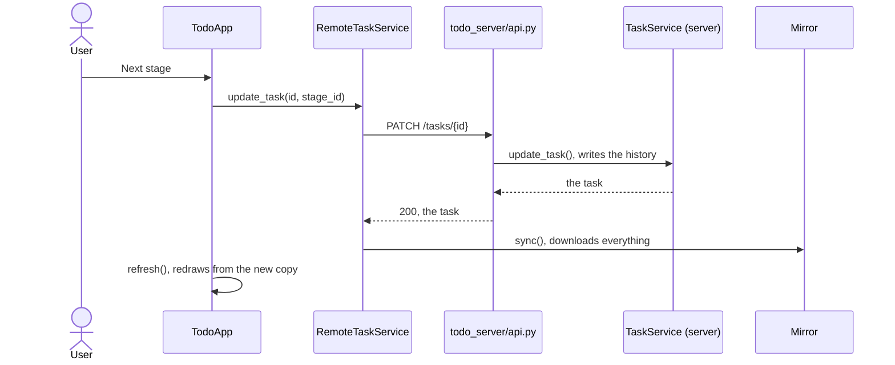
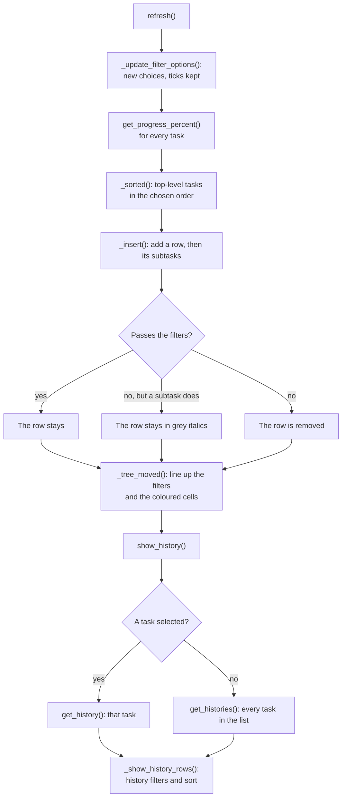
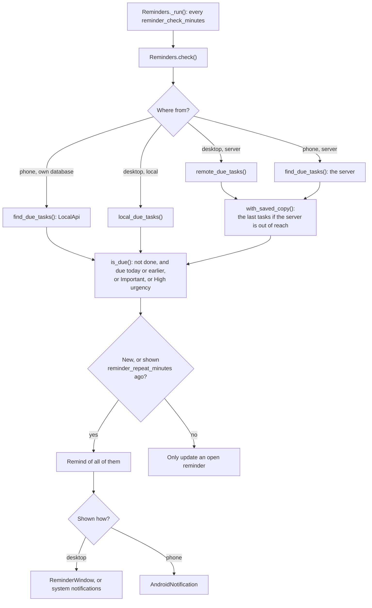
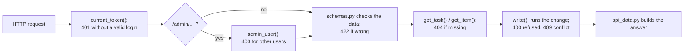
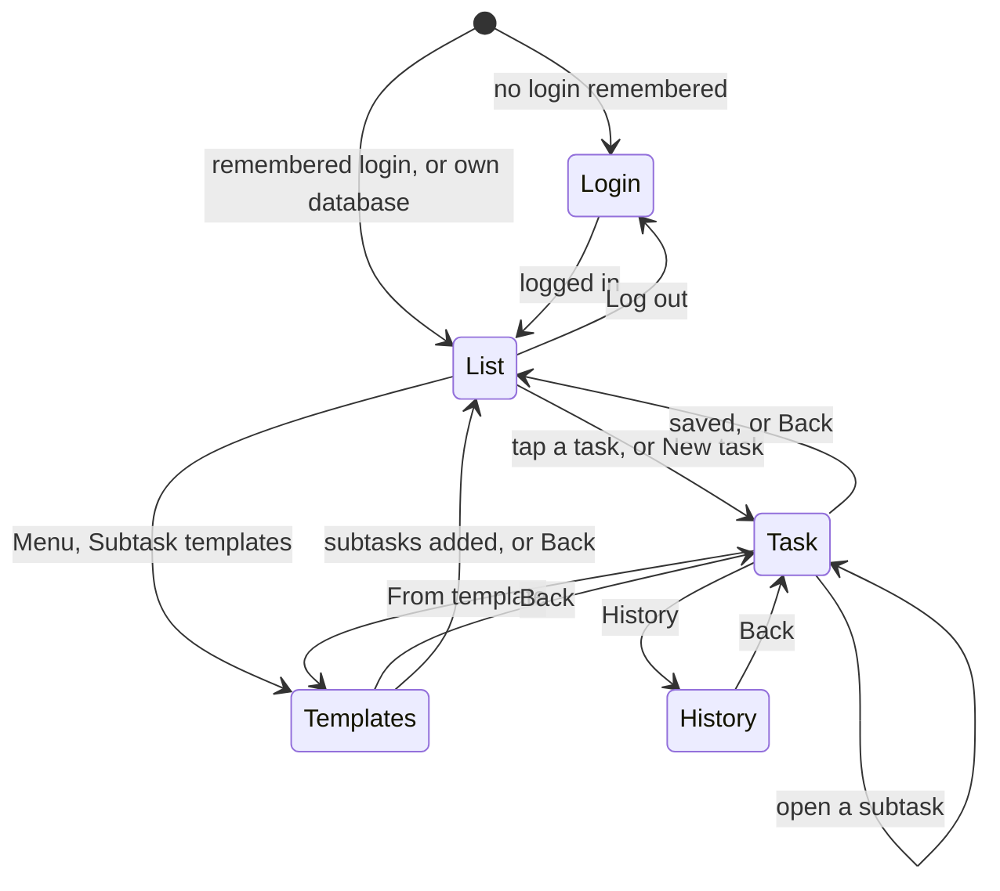

# Code map

How the program is put together. Every function, file by file, is listed in
[FUNCTIONS.md](FUNCTIONS.md). GitHub draws the diagrams below; other Markdown
viewers may need a Mermaid plugin.

## The three programs

The desktop program, the phone app and the server share the code in `todo_db`.
Data lives in one SQLite file: on the computer, on the phone, or on the server.

## Which module uses which

An arrow means "imports"; the main links are shown, not every one. The shared
modules at the bottom know nothing about any window or about the server.

```mermaid
flowchart TB
    subgraph clients["Windows and screens"]
        app["todo_db/app.py"]
        mobile_main["todo_mobile/main.py"]
    end
    subgraph server["Server"]
        api["todo_server/api.py"]
        schemas["schemas.py"]
        security["security.py"]
        dbadmin["dbadmin.py"]
        maintenance["maintenance.py"]
    end
    subgraph phone["Phone helpers"]
        local["local.py"]
        phone_api["api.py"]
        tasks_mobile["tasks.py"]
        storage["storage.py"]
        reminder_service["reminder_service.py"]
    end
    subgraph desktop["Desktop helpers"]
        remote["remote.py"]
        reminders["reminders.py"]
        tray["tray.py"]
    end
    subgraph shared["Shared rules"]
        services["services.py"]
        management["management.py"]
        templates["templates.py"]
        presets["presets.py"]
        pick["pick.py"]
        reminder_core["reminder_core.py"]
        compression["compression.py"]
        api_data["api_data.py"]
        seed["seed.py"]
        database["database.py"]
    end
    models["models.py"]
    base["settings.py and i18n.py"]

    app --> remote & reminders & tray & services & management & templates & presets & pick
    mobile_main --> local & phone_api & tasks_mobile & storage & reminder_service
    mobile_main --> pick & templates & reminder_core
    api --> schemas & security & dbadmin & maintenance
    api --> services & management & templates & api_data & compression & seed & database
    local --> services & management & templates & api_data & seed & database
    remote --> services & management
    reminders --> reminder_core & remote
    reminder_service --> reminder_core
    tasks_mobile --> presets
    services --> models
    management --> models
    templates --> models
    compression --> models
    database --> models
    seed --> models
    api_data --> models
    reminder_core --> base
    presets --> base
    management --> base
```

## The database

`TaskChange.TaskId` has no foreign key on purpose: the history stays after a
task is deleted. `ServerSetting` stands alone.

## The same window in both modes

The desktop windows always read from a SQLAlchemy session and call a service.
Only what stands behind those two differs, which is why the windows do not need
to know which mode they are in.

## What happens when a task changes

In server mode the desktop program keeps an in-memory copy of the server's data,
the *mirror*, and downloads it again after every change and every few seconds.

In local mode the same `update_task` runs in the program itself and the window
redraws from the database directly. On the phone, `LocalApi` answers the same
paths as the server, so the screens do not differ either.

## Drawing the task list

`refresh()` runs after every change and every filter or sort change.

## Reminders

`todo_db/reminder_core.py` holds the rules and the checking thread; the desktop
and the phone only add where the tasks come from and how they are shown.

## A request on the server

A nightly job (`maintenance.py`) resets repeating tasks that are due and, when
that is switched on, compresses old history.

## The phone's screens

