# Every file and function

Written by `docs/make_function_list.py` from the code; do not edit by hand.
The overall diagrams are in [CODE_MAP.md](CODE_MAP.md).

## Shared code and the desktop program (`todo_db`)

### `todo_db/api_data.py`

Rows of the database as the plain data the HTTP API sends (dicts, no pydantic).

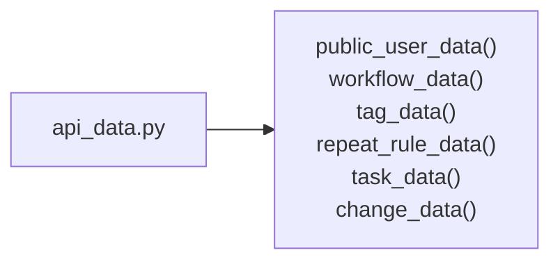

**Functions**

| Function | What it does |
| --- | --- |
| `public_user_data(user)` | What every logged-in user may see about colleagues (e.g. to assign tasks). |
| `workflow_data(workflow)` | A workflow with its stages, as the server sends it. |
| `tag_data(tag)` | A tag, as the server sends it. |
| `repeat_rule_data(rule)` | A repeat rule, as the server sends it. |
| `task_data(service, task)` | A task with everything the clients show (stage, levels, tags, progress...). |
| `change_data(change)` | One history entry; `summary` is set only for compressed rows. |

### `todo_db/app.py`

The to-do program: a Tkinter window on top of TaskService.

```mermaid
flowchart LR
    file["app.py"]
    file --> c0["class TreeTooltip<br/>3 methods"]
    file --> c1["class WrapFrame<br/>1 methods"]
    file --> c2["class Choice<br/>2 methods"]
    file --> c3["class TaskDialog<br/>4 methods"]
    file --> c4["class DatePicker<br/>3 methods"]
    file --> c5["class NameDialog<br/>1 methods"]
    file --> c6["class UsersDialog<br/>7 methods"]
    file --> c7["class WorkflowsDialog<br/>16 methods"]
    file --> c8["class TagsDialog<br/>8 methods"]
    file --> c9["class LocalTemplates<br/>4 methods"]
    file --> c10["class RemoteTemplates<br/>4 methods"]
    file --> c11["class SubtaskTemplatesDialog<br/>10 methods"]
    file --> c12["class RandomTaskWindow<br/>2 methods"]
    file --> c13["class ReminderWindow<br/>1 methods"]
    file --> c14["class LoginWindow<br/>3 methods"]
    file --> c15["class ServerSettingsDialog<br/>2 methods"]
    file --> c16["class RemoteUsersDialog<br/>8 methods"]
    file --> c17["class Filter<br/>0 methods"]
    file --> c18["class MultiChoice<br/>11 methods"]
    file --> c19["class PresetForm<br/>2 methods"]
    file --> c20["class PresetsDialog<br/>7 methods"]
    file --> c21["class SortDialog<br/>9 methods"]
    file --> c22["class TodoApp<br/>95 methods"]
    file --> functions["column_id()<br/>repeat_label()<br/>repeat_sort_key()<br/>use_logo()<br/>database_path()<br/>save_database_path()<br/>choose_database_file()<br/>reminder_display()<br/>run_with_reminders()<br/>run_local()<br/>show_error()<br/>run_remote()<br/>parse_args()<br/>main()"]
```

**Functions**

| Function | What it does |
| --- | --- |
| `column_id(field)` | The Treeview's name for a task list column: #0 for the first. |
| `repeat_label(rule)` | A repeat rule as shown to the user, in the current language. |
| `repeat_sort_key(rule)` | Order rules by unit (days first), then by interval. |
| `use_logo(window)` | Show the program's logo as the icon of this window and of all its dialogs. |
| `database_path()` | Local mode's database file: --db / TODO_DB, else the one chosen last, else todo.db. |
| `save_database_path(path)` | Use this database file from now on (also at the next start). |
| `choose_database_file(parent, current)` | Ask for a database file: an existing one, or a new name to start an empty one. |
| `reminder_display(app)` | The orange reminder window, or system notifications if "reminder_window" is false. |
| `run_with_reminders(app, find_due)` | Run the window with the reminder thread and the tray icon until the program ends. |
| `run_local(path)` | Open the database file (creating it with reference data if new) and run the window. |
| `show_error(text)` | An error message when no window is open. |
| `run_remote(account)` | Run the window logged in to the server; True if the user logged out. |
| `parse_args(argv)` | The command line: --db chooses the database file for this run. |
| `main(argv)` | Start in the mode used last time; show the login window when needed. |

**class `TreeTooltip`** – A small window with a row's text, shown when the mouse rests over a row of a Treeview.

| Function | What it does |
| --- | --- |
| `_moved(event)` | The mouse moved: on a new row, hide the tip and start waiting again. |
| `_show()` | The mouse rested long enough: show the row's text next to the pointer. |
| `hide()` | Remove the window, or stop it from coming; the next row starts afresh. |

**class `WrapFrame`** – Frame that lays out its children left to right and wraps to a new row when full.

| Function | What it does |
| --- | --- |
| `relayout()` | Place the children in rows that fit the current width. |

**class `Choice`** – Read-only combobox that maps the shown labels to values.

| Function | What it does |
| --- | --- |
| `set_options(options, value)` | Replace the options and select the given value (or the first one). |
| `value()` | The value behind the selected label. |

**class `TaskDialog`** – Modal form for a new or existing task; `result` holds the fields on OK.

| Function | What it does |
| --- | --- |
| `__init__(master, session, task, default_assignee_id)` | default_assignee_id: who a new task is assigned to at first (the person adding it). |
| `_rule_changed()` | Choosing how often makes the task repeat forever; "none" makes it once again. |
| `_pick_due_date()` | Choose the due date from a calendar; it starts at the date typed in, if any. |
| `_ok()` | Validate the form and close it with a result. |

**class `DatePicker`** – A month calendar to pick a date from.

| Function | What it does |
| --- | --- |
| `_turn(months)` | Show an earlier or later month. |
| `_show()` | Draw the month: weekday names, then the days in weeks starting on Monday. |
| `_pick(day)` | Close with this day as the result ("" = no date). |

**class `NameDialog`** – Modal prompt for one name; `result` stays None if cancelled or empty.

| Function | What it does |
| --- | --- |
| `_ok()` | Close with the entered name. |

**class `UsersDialog`** – Modal window to add, edit and (de)activate users. Users are never deleted.

| Function | What it does |
| --- | --- |
| `reload(select_id)` | Reload the user list and optionally select one user. |
| `_selected()` | The selected user, or None. |
| `_show_selected()` | Copy the selected user into the form. |
| `_change(action)` | Make a change (management module); show why if it is refused. |
| `add()` | Create a new user from the form. |
| `save()` | Write the form to the selected user. |
| `toggle_active()` | Deactivate or reactivate the selected user. |

**class `WorkflowsDialog`** – Modal window to manage workflows (progression types) and their stages.

| Function | What it does |
| --- | --- |
| `session()` | Where to read from; in server mode a fresh copy after every change. |
| `_make_list(body, column, columns, widths)` | Create one of the two lists. |
| `reload(workflow_id, stage_id)` | Reload both lists, selecting the given workflow (or the first) and stage. |
| `_show_stages()` | List the stages of the selected workflow. |
| `_workflow(warn)` | The selected workflow, or None. |
| `_stage()` | The selected stage, or None. |
| `_ask_name(title, initial)` | Ask for a name; None if cancelled or empty. |
| `_change(action)` | Make a change (management module); show why and return None if it is refused. |
| `add_workflow()` | Create a workflow with a starting "To do" and a final "Done" stage. |
| `rename_workflow()` | Rename the selected workflow. |
| `delete_workflow()` | Delete the selected workflow and its stages, if no task uses them. |
| `add_stage()` | Add a stage at the end of the selected workflow. |
| `rename_stage()` | Rename the selected stage. |
| `shift_stage(delta)` | Move the selected stage up or down. |
| `toggle_final()` | Switch whether tasks in the selected stage count as done. |
| `delete_stage()` | Delete the selected stage, if no task is in it. |

**class `TagsDialog`** – Modal window to add, rename and delete tags.

| Function | What it does |
| --- | --- |
| `session()` | Where to read from; in server mode a fresh copy after every change. |
| `reload(select_id)` | Reload the tag list with the number of tasks using each tag. |
| `_selected()` | The selected tag, or None (telling the user). |
| `_ask_name(title, initial)` | Ask for a name; None if cancelled or empty. |
| `_change(action)` | Make a change (management module); show why and return None if it is refused. |
| `add_tag()` | Create a new tag. |
| `rename_tag()` | Rename the selected tag; tasks keep it under the new name. |
| `delete_tag()` | Delete the selected tag, if no task uses it. |

**class `LocalTemplates`** – The subtask templates of the local database (as plain data, like the server's).

| Function | What it does |
| --- | --- |
| `list()` | All templates, by name. |
| `add(fields)` | Save a new template and return it. |
| `update(template_id, fields)` | Change the given fields of a template and return it. |
| `delete(template_id)` | Delete a template; subtasks made from it stay. |

**class `RemoteTemplates`** – The subtask templates on the application server.

| Function | What it does |
| --- | --- |
| `list()` | All templates on the server, by name. |
| `add(fields)` | Save a new template on the server and return it. |
| `update(template_id, fields)` | Change the given fields of a template on the server and return it. |
| `delete(template_id)` | Delete a template on the server; subtasks made from it stay. |

**class `SubtaskTemplatesDialog`** – Modal window with the editable list of subtask templates.

| Function | What it does |
| --- | --- |
| `_change(action)` | Run a change; show why and return None if it is refused or fails. |
| `reload(select_id)` | Fill the list again; None if the templates could not be loaded. |
| `_selected()` | The templates selected in the list. |
| `_show_selected()` | Put the selected template in the form (the first, if several). |
| `_form()` | The template as typed into the form. |
| `clear_form()` | Empty the form for a new template. |
| `add_template()` | A new template from the form. |
| `save_template()` | Save the form into the selected template. |
| `delete_template()` | Delete the selected templates (subtasks made from them stay). |
| `add_subtasks()` | Close the window with the selected templates as the subtasks to add. |

**class `RandomTaskWindow`** – A task drawn at random (see todo_db.pick), with buttons to draw another or find it.

| Function | What it does |
| --- | --- |
| `draw()` | Draw a task (another one than shown, if there is another). |
| `show_in_list()` | Select the task in the list (clearing the filters if they hide it) and close. |

**class `ReminderWindow`** – The reminder: every due task on an orange background, until the user closes it.

| Function | What it does |
| --- | --- |
| `show(tasks)` | Put the tasks one under another, overdue ones with their date. |

**class `LoginWindow`** – First window: work on this computer, or log in to a server.

| Function | What it does |
| --- | --- |
| `_update()` | The server fields only matter in server mode. |
| `_browse()` | Let the user pick the database file, and put it in the box. |
| `_ok()` | Start local mode, or log in to the server. |

**class `ServerSettingsDialog`** – Server settings for administrators: automatic history compression.

| Function | What it does |
| --- | --- |
| `_update()` | The number of days only matters when compression is on. |
| `_ok()` | Validate and save the settings on the server. |

**class `RemoteUsersDialog`** – Users window for administrators in server mode: accounts, passwords, roles.

| Function | What it does |
| --- | --- |
| `_call(action)` | Run a server call; show its error and return None if it fails. |
| `reload(select_id)` | Fetch the accounts from the server. |
| `_selected()` | The selected account, or None. |
| `_show_selected()` | Copy the selected account into the form. |
| `_form()` | The form as API fields, or None (with a message) if name or email is missing. |
| `add()` | Create a new account from the form. |
| `save()` | Write the form to the selected account. |
| `toggle_active()` | Deactivate or reactivate the selected account. |

**class `Filter`** – One choice of a column filter: its test, and a key that names it in saved presets.

**class `MultiChoice`** – A column filter where several choices can be ticked; a task passes if it matches any.

| Function | What it does |
| --- | --- |
| `set_options(options)` | Replace the choices ("All" = None is left out), keeping the ticks still possible. |
| `chosen_keys()` | The keys ticked, in the order of the list. |
| `set_keys(keys)` | Tick these keys (none = All); False if some of them are not choices (left out). |
| `test()` | Whether a task passes: it matches one of the ticked choices (None = all pass). |
| `_show()` | Show the ticked choices in the box, or "All". |
| `_open(_event)` | Open the list under the box (or close it if open). |
| `_clicked(event)` | A click outside the open list closes it. |
| `_ticked()` | Take over the ticks from the list after a click in it. |
| `_clear()` | The "All" button: untick everything. |
| `_changed()` | Show the new choice and tell the owner. |
| `_close()` | Close the open list, giving the clicks back to the window. |

**class `PresetForm`** – Modal form for one filter preset: its name and filters; `result` holds it on OK.

| Function | What it does |
| --- | --- |
| `__init__(master, preset, taken, title)` | taken: names of the other presets (case is ignored), which this one may not use. |
| `_ok()` | Close with the preset, if its name is filled in and not taken. |

**class `PresetsDialog`** – A list of saved presets (filters or sort orders): apply, add, edit, delete, reorder.

| Function | What it does |
| --- | --- |
| `reload(select)` | List the presets, selecting the one at this position. |
| `_selected()` | Position of the selected preset, or None (telling the user). |
| `apply()` | Use the selected preset now. |
| `add()` | A new preset, starting from what is now set in the main window. |
| `edit()` | Edit the selected preset in its form. |
| `delete()` | Delete the selected preset, after asking. |
| `shift(delta)` | Move the selected preset up (-1) or down (+1) in the list. |

**class `SortDialog`** – Modal window to arrange a list's sort order; `result` holds it on OK.

| Function | What it does |
| --- | --- |
| `__init__(master, sort, preset_name, taken, title, fields)` | With preset_name (even ""), it edits a sort preset: the name is asked too |
| `_show(select)` | Redraw both lists, optionally selecting a chosen field. |
| `_picked()` | Position of the selected field in the sort order, or None. |
| `add()` | Add the selected available field as the last sort level. |
| `remove()` | Take the selected field out of the sort order. |
| `shift(delta)` | Move the selected field one level up or down. |
| `toggle()` | Switch the selected field between ascending and descending. |
| `clear()` | Remove every sort level (back to the manual order). |
| `_ok()` | Close with the arranged order (and, for a preset, a valid name). |

**class `TodoApp`** – Main window: task tree on top, history of the selected task below.

| Function | What it does |
| --- | --- |
| `__init__(session, account, database)` | Work on a local database session, or (with account) on the server. |
| `session()` | Where the window reads from: todo.db, or the current copy of the server's data. |
| `_acting_user_id()` | Who is recorded as making changes. |
| `_build()` | (Re)create all widgets in the current language. |
| `_make_tree(panes, columns, on_scroll)` | Create a Treeview with vertical and horizontal scrollbars in its own frame. |
| `_schedule_midnight()` | Run the repeat check just after the next local midnight. |
| `_at_midnight()` | Reset repeating tasks that are due today, then wait for the next midnight. |
| `_use_tk_language()` | Make Tk's own dialog buttons (Yes/No, OK) follow the language. |
| `change_language()` | Switch to the language picked in the menu and remember it. |
| `_active_users()` | Options for the "Acting as" box. |
| `manage_users()` | Open the users window, then pick up whatever changed there. |
| `manage_workflows()` | Open the workflows window, then pick up whatever changed there. |
| `server_settings()` | Let an administrator change the server's settings. |
| `manage_tags()` | Open the tags window, then pick up whatever changed there. |
| `_management()` | Changes to workflows and tags: on the server when logged in to one. |
| `_templates()` | The subtask templates: on the server when logged in to one. |
| `manage_templates()` | Open the subtask templates window, only to change the list. |
| `_build_filters()` | Create the filter row; its widgets sit right under the column headings. |
| `_place_filters()` | Line the filter widgets up with the current column positions and widths. |
| `_line_up(tree, bar, widgets, widths)` | Place each filter widget in the bar over its column, scrolled along with the list. |
| `_filter_options(column)` | The choices of one column's filter, each with its test. |
| `_update_filter_options()` | Refresh the filter choices (users, tags... may have changed), keeping each pick. |
| `_pick_filter(column, keys)` | Set a column filter to these keys (None = All); False if some no longer exist. |
| `_current_filters()` | The filters now set, as an (unnamed) preset. |
| `apply_preset(preset)` | Set the filters saved in a preset; choices that no longer exist are left at All. |
| `_fill_presets_menu()` | The Filters menu: every saved preset (click = apply), then the actions. |
| `presets_changed()` | Save the presets and show them in the menu. |
| `add_preset(parent)` | Save the filters now set as a new preset (the form lets you name and change them). |
| `edit_preset(index, parent)` | Edit a filter preset in its form; True if it was changed. |
| `manage_presets()` | Open the window that lists, edits and orders the filter presets. |
| `_fill_sort_menu()` | The Sorting menu: every saved sort order (click = apply), then the actions. |
| `sort_presets_changed()` | Save the sort presets and rebuild the Sort menu. |
| `apply_sort(sort)` | Sort the list this way and remember it, as the Sort… window does. |
| `_sort_form(sort, name, taken, title, parent)` | Ask for a sort preset (Sort window with a name); None if cancelled. |
| `add_sort_preset(parent)` | Save the sort order now used as a new preset (the window lets you change it). |
| `edit_sort_preset(index, parent)` | Edit a sort preset in its form; True if it was changed. |
| `manage_sort_presets()` | Open the window that lists, edits and orders the sort presets. |
| `_matches(task, tests)` | Whether the task passes the name filter and every column filter. |
| `clear_filters()` | Reset every filter to show all tasks. |
| `_remember_open(is_open)` | Keep track of collapsed tasks so a refresh does not reopen them. |
| `open_sort()` | Let the user arrange the sort order, then apply and remember it. |
| `_sort_value(field, task)` | The value a task is sorted by for one field; None sorts last. |
| `_sorted(tasks)` | Siblings in the chosen sort order; ties keep the manual order. |
| `_update_headings()` | Show ▲/▼ (and the level, if several) on the columns being sorted by. |
| `_heading(field, sort)` | A column's title with its place in the sort order, if any. |
| `refresh()` | Reload the task tree with the filters applied, keeping the selection. |
| `_insert(task, parent_iid, tests, filtering, depth)` | Add a task row and its subtasks; return whether anything was shown. |
| `_tree_moved()` | The list scrolled, resized or changed: line up the filters and the coloured cells. |
| `_place_level_cells()` | Lay a coloured label over the Priority and Urgency cell of every visible row. |
| `_make_level_cell()` | A label for one coloured cell; clicks, scrolling and hovering act on its row. |
| `_task_description(iid)` | The description of the task in a row of the list ("" if none). |
| `show_history()` | Show the description and history of the selected task, or with none selected |
| `_shown_task_ids(parent)` | The tasks in the list, closed parents' subtasks included. |
| `_tree_clicked(event)` | A click on the selected task or on the empty space below the tasks unselects. |
| `_edit_row(iid)` | Edit the double-clicked task (its first click may have unselected it). |
| `unselect()` | Select no task: the history then covers all the tasks in the list. |
| `_show_history_rows()` | List the selected task's changes with the history's filters and sort order. |
| `_history_row(change)` | The texts of a change's row, in the order of HISTORY_COLUMNS. |
| `_history_sort_value(field, row)` | The value a history row is sorted by for one field; None (empty) sorts last. |
| `_build_history_filters()` | Create the history's filter row, above its column headings like the tasks' one. |
| `_place_history_filters()` | Line the history's filter widgets up with its columns. |
| `_history_filter_options(column)` | The choices of one history column's filter, each with its test. |
| `clear_history_filters()` | Reset the history's filters to show every change. |
| `open_history_sort()` | Let the user arrange the history's sort order, then apply and remember it. |
| `_summary_texts(summary)` | A compressed history row as (time span and count, net field changes). |
| `_history_value(field_name, value)` | A stored history value, with "(none)" and priority/urgency names translated. |
| `_selected(warn)` | The selected task, or None (optionally telling the user). |
| `_run(action)` | Run a service call, show its error if it fails, then reload. |
| `sync()` | Download the server's current data (other people's changes too). |
| `_sync_tick()` | Every few seconds: pick up other people's changes, unless a window is open. |
| `_show_connection()` | Server mode: whether the server could be reached the last time it was asked. |
| `post_reminders(due, popup)` | Called by the reminder thread; Tk may only be used from the window's thread. |
| `call_soon(action)` | Run an action in the window's thread; safe to call from any thread. |
| `_poll_reminders()` | Run handed-over work; show (or update) the reminder window with what was found. |
| `log_out()` | End the server login (or leave local mode) and go back to the login window. |
| `change_database()` | Local mode: work on another database file (an empty one is set up if new). |
| `close()` | Window closed: with a tray icon the program keeps running there, else it quits. |
| `show_window()` | Bring the window back (from the tray). |
| `quit_program()` | Really quit: a login that is not remembered ends here. |
| `_ask(task)` | Show the task form and return its fields, or None if cancelled. |
| `_create(parent_id)` | Ask for a new task and create it under the given parent. |
| `new_task()` | Create a top-level task. |
| `new_subtask()` | Create a subtask of the selected task. |
| `subtasks_from_template()` | Add subtasks to the selected task from templates chosen in the templates window. |
| `random_candidates()` | The tasks a random draw picks from: unfinished and without subtasks. |
| `random_task()` | Show a task drawn at random, favouring the important and urgent ones. |
| `show_task(task_id)` | Select a task in the list and scroll to it; clear the filters if they hide it. |
| `edit_task()` | Edit the selected task; only the changed fields are logged. |
| `_set_stage(task, stage)` | Move the task to a stage. |
| `next_stage()` | Move the selected task to the next stage of its workflow. |
| `complete()` | Move the selected task to the final stage of its workflow. |
| `shift(delta)` | Move the selected task up or down among its siblings. |
| `indent()` | Make the selected task the last subtask of the task above it. |
| `outdent()` | Move the selected subtask one level up, right after its parent. |
| `delete()` | Delete the selected task after confirmation. |

### `todo_db/compression.py`

History compression: many old TaskChange rows of a task become one summary row.

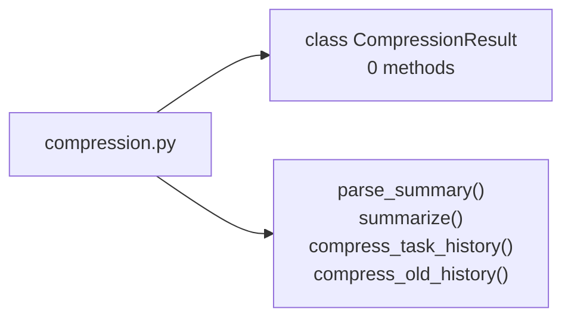

**Functions**

| Function | What it does |
| --- | --- |
| `parse_summary(change)` | The summary stored in a Compressed row, or None for other rows. |
| `_summarize(rows)` | Merge rows (oldest first, possibly including an earlier summary) into one summary. |
| `compress_task_history(session, task_id, older_than)` | Merge the task's history rows (all, or only those before `older_than`) into one row. |
| `compress_old_history(session, older_than_days, now)` | Compress, for every task, all history rows older than the given number of days. |

**class `CompressionResult`** – What a compression run did.

### `todo_db/database.py`

Engine and session setup for SQLite.

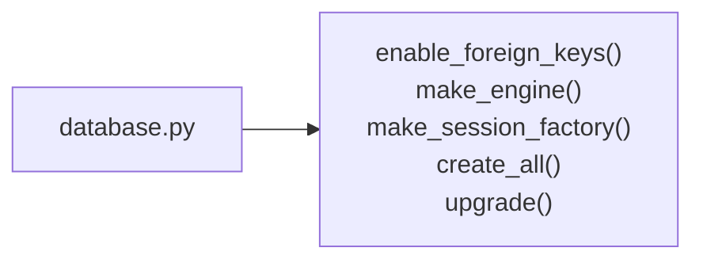

**Functions**

| Function | What it does |
| --- | --- |
| `_enable_foreign_keys(dbapi_connection, connection_record)` | SQLite ignores foreign keys unless asked on every connection. |
| `make_engine(url)` | Create an engine with foreign key enforcement switched on. |
| `make_session_factory(engine)` | Return a session factory bound to the engine. |
| `create_all(engine)` | Create all tables that do not exist yet and upgrade older databases. |
| `_upgrade(engine)` | Add columns introduced after a database was first created. |

### `todo_db/i18n.py`

Interface languages for the to-do program.

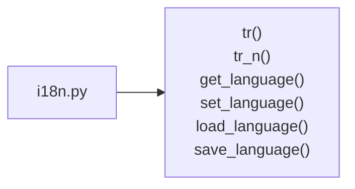

**Functions**

| Function | What it does |
| --- | --- |
| `tr(text)` | Translate an English interface text into the current language. |
| `tr_n(text, n)` | Translate a text with a count {n}, choosing the plural form. |
| `get_language()` | Code of the current language. |
| `set_language(code)` | Switch the current language; unknown codes fall back to English. |
| `load_language()` | The saved language, else the system language if supported, else English. |
| `save_language(code)` | Remember the language for the next start. |

### `todo_db/main.py`

Demo: create the database, seed it, print the tasks and their history.

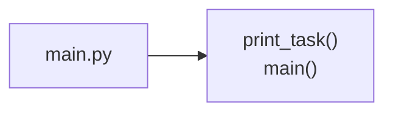

**Functions**

| Function | What it does |
| --- | --- |
| `print_task(service, task, indent)` | Print one task line and, below it, its subtasks. |
| `main()` | Rebuild demo.db from scratch and show what is in it. |

### `todo_db/management.py`

Users, workflows (with their stages) and tags of a local database: add, change, delete.

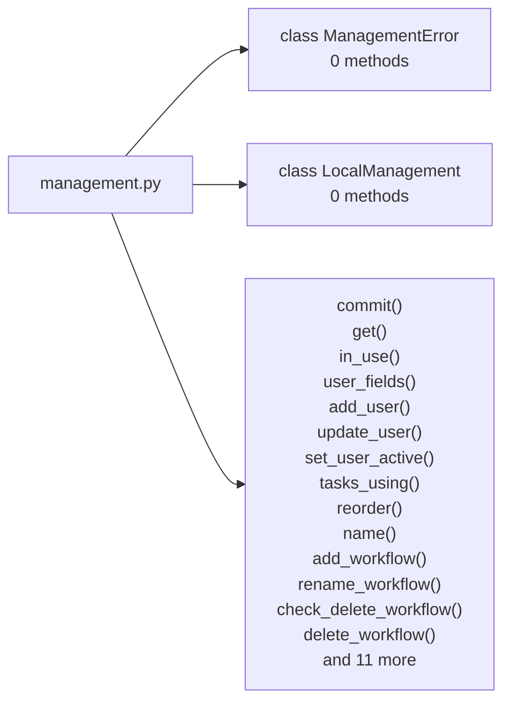

**Functions**

| Function | What it does |
| --- | --- |
| `_commit(session, error)` | Save the pending change; on failure undo it and raise with the (translated) message. |
| `_get(session, model, item_id)` | The item with this id, or ManagementError if there is none. |
| `_in_use(name, used)` | The error saying that tasks still use this item. |
| `_user_fields(name, email)` | A user's name and email, cleaned up; refuses an empty name. |
| `add_user(session, name, email)` | A new user; refused if the email is taken. |
| `update_user(session, user_id, name, email)` | Change a user's name and email; refused if the email is taken. |
| `set_user_active(session, user_id, active)` | Deactivate or reactivate a user (users are never deleted); one must stay active. |
| `_tasks_using(session, stage_ids)` | Number of tasks in one of the stages. |
| `_reorder(session, stages)` | Give the stages Order 1..n in list order. |
| `_name(name)` | A name without surrounding spaces; refuses an empty one. |
| `add_workflow(session, name)` | A workflow with a starting "To do" and a final "Done" stage. |
| `rename_workflow(session, workflow_id, name)` | Give a workflow a new, unused name. |
| `check_delete_workflow(session, workflow_id)` | The workflow, if it may be deleted (another one remains, no task uses it). |
| `delete_workflow(session, workflow_id)` | Delete a workflow and its stages, if no task uses them. |
| `add_stage(session, workflow_id, name)` | A stage at the end of the workflow. |
| `rename_stage(session, stage_id, name)` | Give a stage a new name. |
| `shift_stage(session, stage_id, delta)` | Move a stage up (-1) or down (+1) in its workflow; at either end nothing happens. |
| `set_stage_final(session, stage_id, is_final)` | Whether tasks in the stage count as done. |
| `check_delete_stage(session, stage_id)` | The stage, if it may be deleted (not the last of its workflow, no task in it). |
| `delete_stage(session, stage_id)` | Delete a stage, if no task is in it; the others are numbered again. |
| `tag_usage(session)` | Every tag (by name) with the number of tasks that have it. |
| `add_tag(session, name)` | A new tag; refused if the name is taken. |
| `rename_tag(session, tag_id, name)` | Rename a tag; tasks keep it under the new name. |
| `check_delete_tag(session, tag_id)` | The tag, if no task uses it. |
| `delete_tag(session, tag_id)` | Delete a tag, if no task uses it. |

**class `ManagementError`** – A change that is refused or could not be saved (message for the user).

**class `LocalManagement`** – These functions on one local database, without passing the session each time.

### `todo_db/models.py`

SQLAlchemy models and enums for the to-do list database.

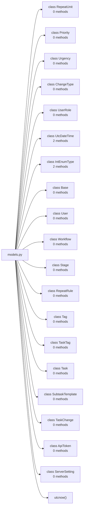

**Functions**

| Function | What it does |
| --- | --- |
| `utcnow()` | Return the current time as a timezone-aware UTC datetime. |

**class `RepeatUnit`** – Unit of a repeat interval.

**class `Priority`** – Task priority, stored as an integer so it sorts naturally.

**class `Urgency`** – How soon a task needs doing (independent of how important it is).

**class `ChangeType`** – Kind of entry in the task history.

**class `UserRole`** – What a user may do on the application server.

**class `UtcDateTime`** – DateTime that is always timezone-aware UTC (SQLite drops the tzinfo).

| Function | What it does |
| --- | --- |
| `process_bind_param(value, dialect)` | Going into the database: UTC, without the time zone. |
| `process_result_value(value, dialect)` | Coming out of the database: mark it as UTC again. |

**class `IntEnumType`** – Stores an IntEnum (Priority, Urgency) as its integer value.

| Function | What it does |
| --- | --- |
| `process_bind_param(value, dialect)` | Going into the database: the level's number. |
| `process_result_value(value, dialect)` | Coming out of the database: the level for the number. |

**class `Base`** – Base class for all models.

**class `User`** – A person who creates or is assigned tasks. Deactivated, never deleted.

**class `Workflow`** – A named set of stages.

**class `Stage`** – One step of a workflow; IsFinal marks the "Done" stage.

**class `RepeatRule`** – How often a repeating task comes back.

**class `Tag`** – A label that can be attached to many tasks.

**class `TaskTag`** – Association row between Task and Tag.

**class `Task`** – A to-do item. Subtasks are the tasks whose ParentId points here.

**class `SubtaskTemplate`** – A ready-made subtask ("Write tests", "Pack the car") to add to any task.

**class `TaskChange`** – One entry of the task history / audit log.

**class `ApiToken`** – A login session of the application server. Only a hash of the token is stored.

**class `ServerSetting`** – One setting of the application server, e.g. how old history gets compressed.

### `todo_db/pick.py`

Draw a random task to do next, favouring the important and urgent ones.

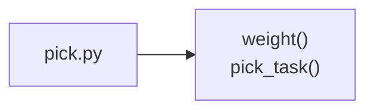

**Functions**

| Function | What it does |
| --- | --- |
| `weight(priority, urgency)` | How strongly a task with these levels (by name) is favoured; 1 if unknown. |
| `pick_task(candidates, levels, rng)` | One of the candidates at random, by weight; None if there are none. |

### `todo_db/presets.py`

The task list's columns, sorting and saved presets, shared by the computer and the phone.

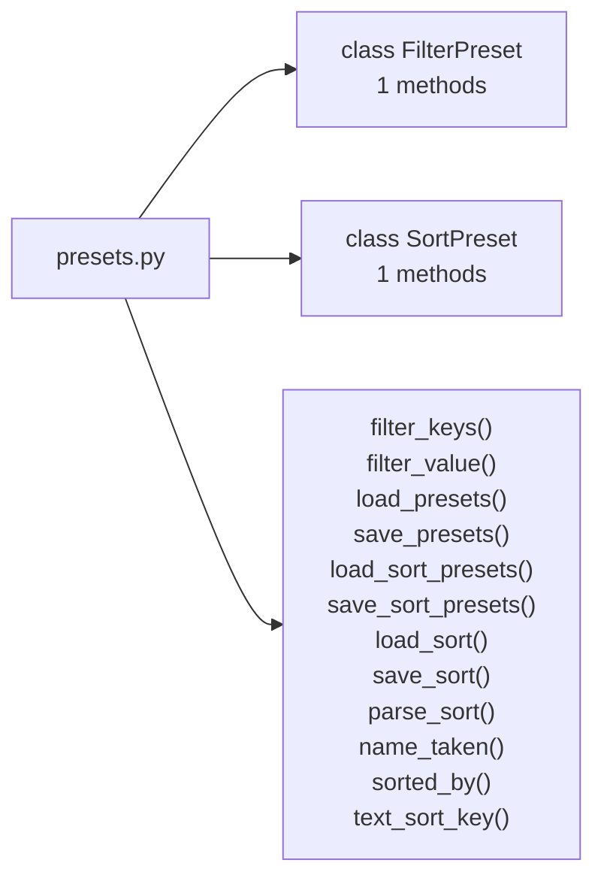

**Functions**

| Function | What it does |
| --- | --- |
| `filter_keys(value)` | The keys of one column's saved filter ([] = all tasks pass). |
| `filter_value(keys)` | How chosen keys are saved: None for none, the key for one, else the list. |
| `load_presets()` | The saved filter presets from settings.json; broken entries are skipped. |
| `save_presets(presets)` | Keep the filter presets in settings.json. |
| `load_sort_presets()` | The saved sort presets from settings.json; broken entries are skipped. |
| `save_sort_presets(presets)` | Keep the sort presets in settings.json. |
| `load_sort()` | The saved sort order as (field, descending) pairs; [] if none or invalid. |
| `save_sort(sort)` | Keep the current sort order of the task list in settings.json. |
| `parse_sort(saved, fields)` | [[field, descending], ...] from settings.json, without unknown or repeated fields. |
| `name_taken(name, others)` | Whether a preset name is already used by another preset (case is ignored). |
| `sorted_by(items, sort, value)` | Items in the sort order (value(field, item) is what is compared; None sorts last). |
| `text_sort_key(text)` | Case-insensitive key that orders text alphabetically, Polish letters included. |

**class `FilterPreset`** – Saved filters: the search text and the chosen keys of each column filter.

| Function | What it does |
| --- | --- |
| `as_json()` | The preset as it is kept in settings.json. |

**class `SortPreset`** – A saved sort order: (field, descending) pairs, most important first.

| Function | What it does |
| --- | --- |
| `as_json()` | The preset as it is kept in settings.json. |

### `todo_db/reminder_core.py`

Reminders without a user interface: which tasks need one, and when to remind of them.

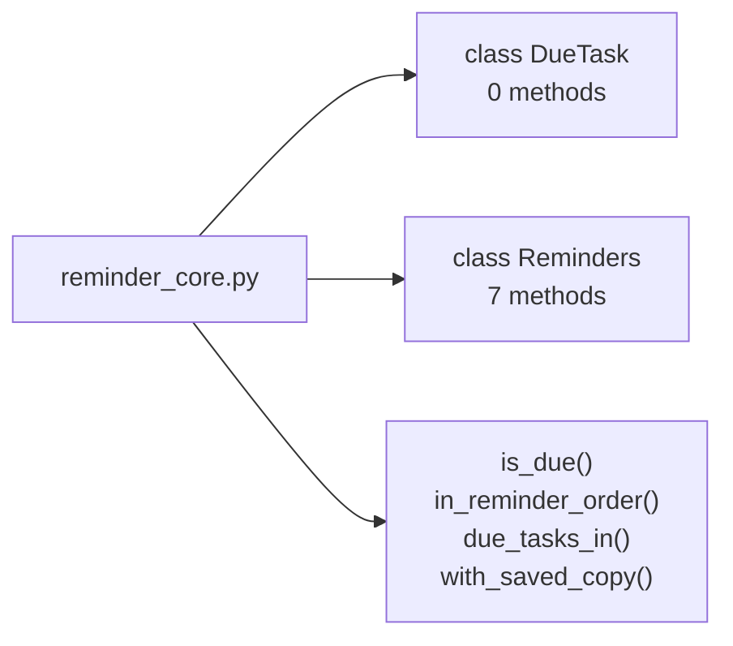

**Functions**

| Function | What it does |
| --- | --- |
| `is_due(due_date, done, today, priority, urgency)` | Whether a task needs a reminder: not done, and due today or earlier, or important |
| `in_reminder_order(tasks)` | Oldest due date first, tasks without one last. |
| `due_tasks_in(tasks, today, user_id, only_mine)` | The tasks to remind of among tasks as the server sends them (dicts); oldest due first. |
| `with_saved_copy(fetch, saved, logged_out)` | fetch()'s answer from the server, also kept in the file saved; the kept one offline. |

**class `DueTask`** – An unfinished task to remind of: due today or earlier, important or urgent.

**class `Reminders`** – Checks for due tasks in a background thread and shows them when it is time.

| Function | What it does |
| --- | --- |
| `__init__(find_due)` | find_due(today) lists the due tasks. |
| `check(force)` | One round: remind if it is time (force: in any case if something is due). |
| `set_enabled(enabled)` | Switch reminders on or off, now and for the next start (settings.json). |
| `check_now()` | Check at once and show every due task, even ones shown a moment ago. |
| `start()` | Start checking in the background: now, then every check interval. |
| `stop()` | Stop checking (waits briefly for a check in progress). |
| `_run()` | The background thread: check, wait for the interval or a wake-up, repeat. |

### `todo_db/reminders.py`

Reminders: about unfinished tasks due today or overdue, or important or urgent.

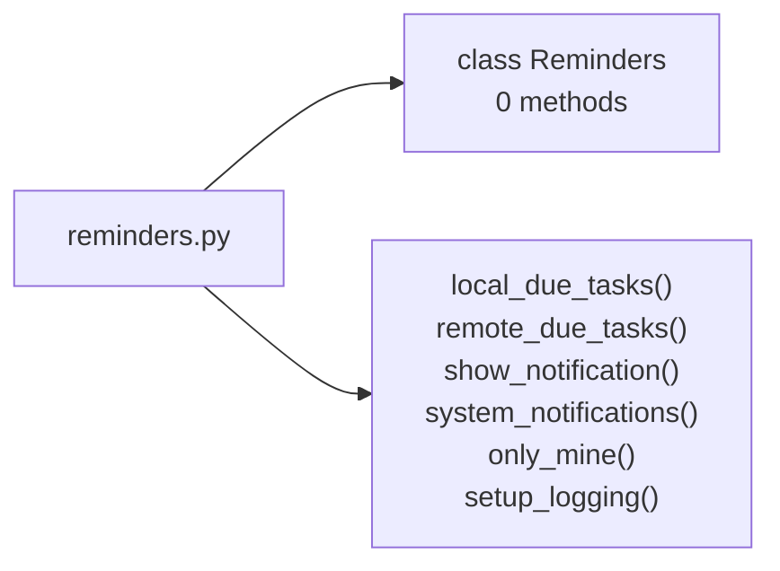

**Functions**

| Function | What it does |
| --- | --- |
| `local_due_tasks(session_factory, today)` | Tasks to remind of in todo.db; uses its own session, so it is safe in another thread. |
| `remote_due_tasks(api, user_id, today, only_mine)` | Due tasks on the server; only_mine: just those assigned to the user or to nobody. |
| `show_notification(title, message)` | A native system notification; raises if the system cannot show it. |
| `system_notifications(due, popup)` | Show the due tasks as system notifications, one each (nothing to update in between). |
| `only_mine()` | Whether server mode reminds only of the user's own and unassigned tasks. |
| `setup_logging()` | Send the program's log (reminder problems among it) to LOG_FILE. |

**class `Reminders`** – The shared checker; shows system notifications unless given another display.

### `todo_db/remote.py`

Working against the application server instead of the local todo.db.

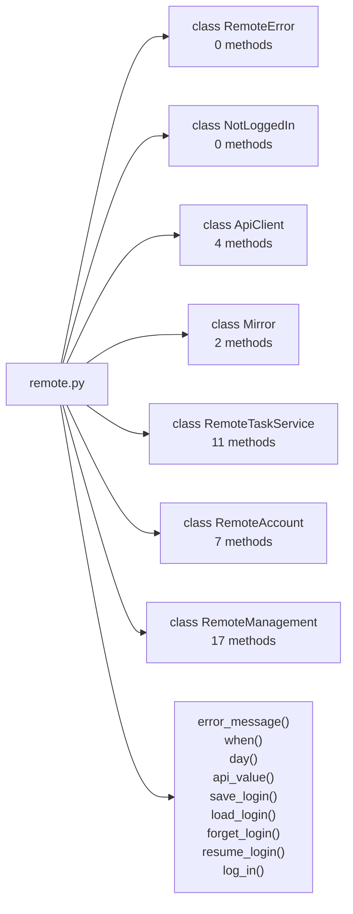

**Functions**

| Function | What it does |
| --- | --- |
| `_error_message(response)` | The server's explanation of an error, as plain text. |
| `_when(value)` | A time as the server sends it, or None. |
| `_day(value)` | A date as the server sends it, or None. |
| `_api_value(value)` | Enums travel by name ("Important"), dates as "2026-10-14", everything else as is. |
| `save_login(base_url, token)` | Remember the login for the next start, in a file only the owner can read. |
| `load_login()` | (server address, token) of a remembered login, or None. |
| `forget_login()` | Delete the remembered login. |
| `resume_login()` | Log in again with a remembered token, if it is still valid. |
| `log_in(base_url, email, password, remember)` | Log in with email and password; raises RemoteError with a message for the user. |

**class `RemoteError`** – The server refused a request or could not be reached (message for the user).

**class `NotLoggedIn`** – The login expired or was ended on the server; the user must log in again.

**class `ApiClient`** – Thin wrapper around the server's HTTP API.

| Function | What it does |
| --- | --- |
| `request(method, path, body)` | Send a request; returns the JSON answer or raises RemoteError. |
| `login(email, password)` | Log in; keeps the token and returns the server's answer (token, user...). |
| `logout()` | End the login on the server; errors are ignored (we forget the token anyway). |
| `close()` | Close the connection to the server. |

**class `Mirror`** – An in-memory copy of the server's users, workflows, tags, rules and tasks.

| Function | What it does |
| --- | --- |
| `sync()` | Download everything again into a fresh in-memory database. |
| `_build()` | Download everything and load it into a new in-memory database. |

**class `RemoteTaskService`** – Does what TaskService does, but on the server; the desktop program can't tell.

| Function | What it does |
| --- | --- |
| `_api()` | The connection of the logged-in account. |
| `_after_change(task_id)` | Download the changes; the changed task from the new copy. |
| `create_task(name, stage_id, created_by_id)` | created_by_id is ignored: the server records the logged-in user. |
| `update_task(task_id, changed_by_id)` | Change the given fields; only they are sent, by name. |
| `move_task(task_id, new_parent_id, new_order, changed_by_id)` | Give a task another parent and/or place among its siblings. |
| `delete_task(task_id, changed_by_id)` | Delete a task on the server. |
| `get_history(task_id)` | The task's history from the server, as (unsaved) TaskChange objects. |
| `get_histories(task_ids)` | The changes of all these tasks together, oldest first. |
| `_change(row)` | A history entry from the server as an (unsaved) TaskChange. |
| `get_progress_percent(task_id)` | Calculated from the mirror, exactly as the server would. |
| `reset_due_tasks(now)` | The server resets repeating tasks itself; here we only fetch the result. |

**class `RemoteAccount`** – A logged-in connection to the server.

| Function | What it does |
| --- | --- |
| `is_admin()` | Whether the logged-in user is an administrator. |
| `list_users()` | All accounts with their email and role. |
| `create_user(fields)` | Add an account and return it. |
| `update_user(user_id, fields)` | Change the given fields of an account and return it. |
| `get_settings()` | {"auto_compress_enabled": bool, "compress_after_days": int} |
| `save_settings(values)` | Save the server's settings and return them. |
| `logout()` | End the login on the server and forget a remembered one. |

**class `RemoteManagement`** – What management.LocalManagement does, on the server: workflows, stages and tags.

| Function | What it does |
| --- | --- |
| `session()` | The current copy of the server's data (replaced at every sync). |
| `_send(method, path, body)` | Make a change on the server and download the result. |
| `add_workflow(name)` | A new workflow on the server. |
| `rename_workflow(workflow_id, name)` | Rename a workflow on the server. |
| `check_delete_workflow(workflow_id)` | The workflow, if the local copy shows it may be deleted. |
| `delete_workflow(workflow_id)` | Delete a workflow on the server, which checks again. |
| `add_stage(workflow_id, name)` | A new stage at the end of a workflow on the server. |
| `rename_stage(stage_id, name)` | Rename a stage on the server. |
| `shift_stage(stage_id, delta)` | Move a stage up (-1) or down (+1) on the server. |
| `set_stage_final(stage_id, is_final)` | Set on the server whether tasks in the stage count as done. |
| `check_delete_stage(stage_id)` | The stage, if the local copy shows it may be deleted. |
| `delete_stage(stage_id)` | Delete a stage on the server, which checks again. |
| `tag_usage()` | Every tag with its number of tasks, from the local copy. |
| `add_tag(name)` | A new tag on the server. |
| `rename_tag(tag_id, name)` | Rename a tag on the server. |
| `check_delete_tag(tag_id)` | The tag, if the local copy shows it may be deleted. |
| `delete_tag(tag_id)` | Delete a tag on the server, which checks again. |

### `todo_db/seed.py`

Sample data. Tasks are created through TaskService so the history is real.

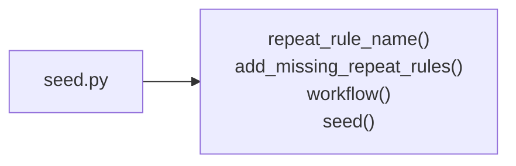

**Functions**

| Function | What it does |
| --- | --- |
| `repeat_rule_name(interval, unit)` | English name of a rule: "Daily", "Every 3 days", "Every 2 weeks", ... |
| `add_missing_repeat_rules(session)` | Add every rule from REPEAT_RULES that the database does not have yet. |
| `_workflow(name, stage_names)` | Build a workflow whose last stage is the final one. |
| `seed(session, with_tasks, with_users)` | Fill an empty database with sample users, workflows, tags and tasks. |

### `todo_db/services.py`

TaskService: every write to a task goes through here, together with its history.

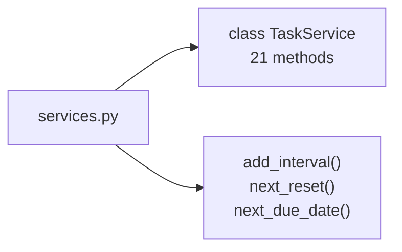

**Functions**

| Function | What it does |
| --- | --- |
| `add_interval(day, interval, unit)` | The date `interval` units after `day`; month ends are clamped (Jan 31 + 1 month = Feb 28/29). |
| `next_reset(completed_at, rule)` | Local midnight starting the day the task is due again, in UTC. |
| `next_due_date(due, rule, today, completed)` | The next due date of a repeating task, in its cycle (due, due + interval, ...). |

**class `TaskService`** – Creates, changes and deletes tasks, logging every change.

| Function | What it does |
| --- | --- |
| `__init__(session, clock)` | clock returns the current UTC time; tests pass a fake one. |
| `create_task(name, stage_id, created_by_id)` | Create a task at the end of its siblings and log a Created row. |
| `update_task(task_id, changed_by_id)` | Change the given fields and log one row per field that really changed. |
| `move_task(task_id, new_parent_id, new_order, changed_by_id)` | Move a task to a parent and position (1-based; None = at the end). |
| `delete_task(task_id, changed_by_id)` | Log a Deleted row and delete the task. Refused if it has subtasks. |
| `reset_due_tasks(now)` | Send repeating tasks whose reset time has come back to their first stage. |
| `roll_missed_due_dates(now)` | Move repeating tasks whose due date passed undone to their next date in the cycle. |
| `get_history(task_id)` | Return the task's changes, oldest first. |
| `get_histories(task_ids)` | The changes of all these tasks together, oldest first. |
| `get_progress_percent(task_id)` | How far the task is, 0-100. |
| `_transaction()` | Commit on success, roll everything back on any error. |
| `_get(model, row_id)` | Load a row by id or raise ValueError. |
| `_text(field, value)` | Turn a field value into the text stored in the history. |
| `_log(task, changed_by_id, change_type, field, old, new)` | Add a history row (changed_by_id None = automatic system change). |
| `_set_field(task, field, value, changed_by_id)` | Set a plain field and log it as Updated if it changed. |
| `_set_tags(task, tag_ids, changed_by_id)` | Replace the task's tags and log the change as one Updated row. |
| `_set_stage(task, stage_id, changed_by_id)` | Change the stage; handle completion and the repeat cycle. |
| `_move_due_date(task, due_date)` | Give a repeating task its next due date; logged as a system change. |
| `_siblings(parent_id, exclude_id)` | Tasks with the given parent, in order, optionally without one task. |
| `_renumber(tasks)` | Make Order contiguous: 1, 2, 3, ... |
| `_move(task, new_parent_id, new_order, changed_by_id)` | Re-parent and/or reorder a task, keeping sibling orders contiguous. |

### `todo_db/settings.py`

Per-user program settings, kept in settings.json in the current directory.

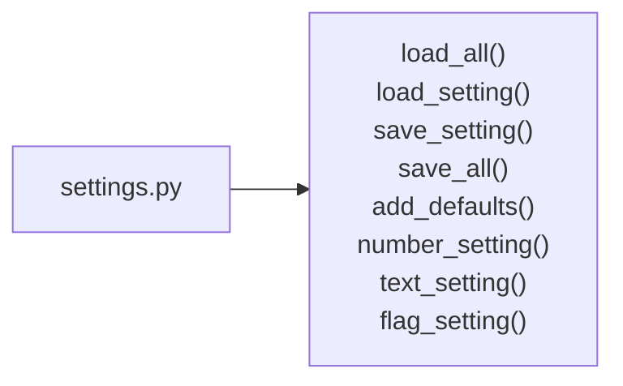

**Functions**

| Function | What it does |
| --- | --- |
| `_load_all()` | All saved settings; empty if the file is missing or broken. |
| `load_setting(key, default)` | One saved setting, or the default. |
| `save_setting(key, value)` | Save one setting, keeping the others. |
| `_save_all(data)` | Write all the settings to settings.json. |
| `add_defaults(defaults)` | Write the settings missing from the file with their defaults; others stay as set. |
| `number_setting(key, default)` | A positive number from the file, or the default (a wrong value is logged). |
| `text_setting(key, default)` | A non-empty text from the file, or the default (a wrong value is logged). |
| `flag_setting(key, default)` | true/false from the file, or the default (a wrong value is logged). |

### `todo_db/templates.py`

Subtask templates: a list of ready-made subtasks to add to any task.

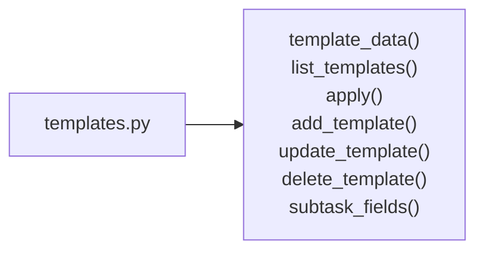

**Functions**

| Function | What it does |
| --- | --- |
| `template_data(template)` | A template as plain data, with the levels by name. |
| `list_templates(session)` | All templates, by name. |
| `_apply(template, fields)` | Set the fields given (levels by name); a name must not be empty. |
| `add_template(session, fields)` | A new template, Normal and Medium unless given; the name must be free. |
| `update_template(session, template_id, fields)` | Change the given fields of a template; the name must stay free. |
| `delete_template(session, template_id)` | Delete a template; subtasks made from it stay as they are. |
| `subtask_fields(template, parent)` | The new subtask's fields (as POST /tasks takes them) for a template and a parent. |

### `todo_db/tray.py`

The icon in the system tray, so the program can keep running with its window closed.

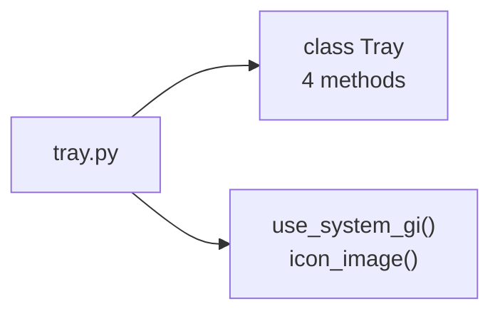

**Functions**

| Function | What it does |
| --- | --- |
| `_use_system_gi()` | Make the system's PyGObject importable if the virtual environment lacks it. |
| `icon_image(size)` | The tray icon: the program's logo (a white tick on an orange circle if it is missing). |

**class `Tray`** – The tray icon and its menu; start() says whether it could be shown.

| Function | What it does |
| --- | --- |
| `start()` | Show the icon (in a background thread); False if there is no tray support. |
| `_run()` | The icon's own thread; a failure only goes to the log. |
| `refresh_menu()` | Show changed check marks (e.g. reminders switched off in the window). |
| `stop()` | Remove the icon and wait briefly for its thread to end. |

## The application server (`todo_server`)

### `todo_server/__main__.py`

Command line: run the server and manage accounts.

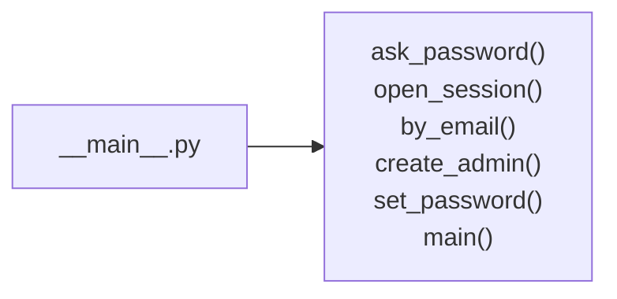

**Functions**

| Function | What it does |
| --- | --- |
| `ask_password()` | Read a new password twice without showing it (or two lines piped in, for scripts). |
| `open_session(db_path)` | A session on the server database (created and upgraded if needed). |
| `by_email(session, email)` | The user with this email, in any letter case. |
| `create_admin(db_path, name, email)` | The create-admin command: a new administrator; 1 if the email exists. |
| `set_password(db_path, email)` | The set-password command: a new password; 1 if there is no such user. |
| `main(argv)` | Read the command line and run the server or one of the commands. |

### `todo_server/api.py`

The HTTP API of the to-do application server (FastAPI).

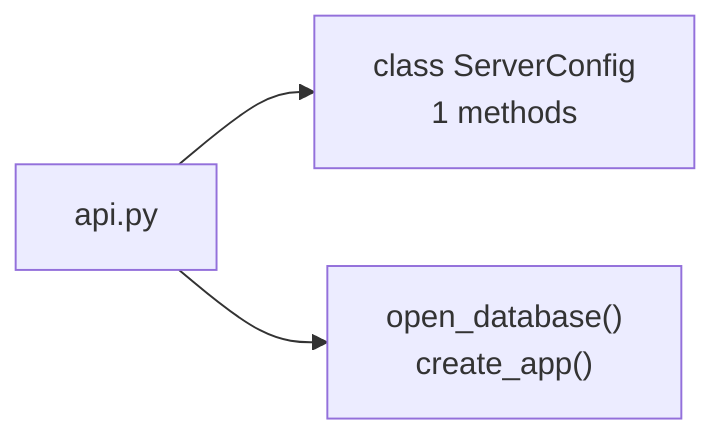

**Functions**

| Function | What it does |
| --- | --- |
| `open_database(db_path)` | Engine for the server: usable from several threads, waits when the file is busy. |
| `create_app(config)` | Build the application (one per database). |

**class `ServerConfig`** – Where the server keeps its data and how it behaves.

| Function | What it does |
| --- | --- |
| `backups()` | Where backups go: backup_dir, or backups/ next to the database. |

### `todo_server/dbadmin.py`

Database management: server settings, statistics, backups and VACUUM.

```mermaid
flowchart LR
    file["dbadmin.py"]
    file --> c0["class ServerSettings<br/>0 methods"]
    file --> functions["load_settings()<br/>save_settings()<br/>save_last_maintenance()<br/>load_last_maintenance()<br/>statistics()<br/>backup()<br/>list_backups()<br/>backup_file()<br/>vacuum()"]
```

**Functions**

| Function | What it does |
| --- | --- |
| `load_settings(session)` | Current settings; anything never saved keeps its default. |
| `save_settings(session, settings)` | Store all settings and commit. |
| `save_last_maintenance(session, report)` | Remember what the last maintenance run did; commits. |
| `load_last_maintenance(session)` | What the last maintenance run did, or None. |
| `statistics(session, db_path)` | Size and contents of the database. |
| `backup(db_path, backup_dir)` | Copy the live database into backup_dir with SQLite's online backup. |
| `list_backups(backup_dir)` | Backups, newest first. |
| `backup_file(backup_dir, name)` | The path of a backup by name, or None (names are checked, so no "../" tricks). |
| `vacuum(engine, db_path)` | Rebuild the database file so space freed by deletes is given back. |

**class `ServerSettings`** – Settings an administrator can change while the server runs.

### `todo_server/maintenance.py`

Nightly jobs: reset repeating tasks that are due and, if enabled, compress old history.

```mermaid
flowchart LR
    file["maintenance.py"]
    file --> functions["run_maintenance()<br/>seconds_until_next_midnight()<br/>scheduler()"]
```

**Functions**

| Function | What it does |
| --- | --- |
| `run_maintenance(session_factory, now)` | Run all jobs once and return (and store) what they did. |
| `seconds_until_next_midnight()` | Seconds until just after the next local midnight. |
| `scheduler(session_factory)` | Run maintenance at start-up and after every local midnight, forever. |

### `todo_server/schemas.py`

Request and response bodies of the HTTP API.

```mermaid
flowchart LR
    file["schemas.py"]
    file --> c0["class LoginIn<br/>0 methods"]
    file --> c1["class UserOut<br/>0 methods"]
    file --> c2["class PublicUserOut<br/>0 methods"]
    file --> c3["class TokenOut<br/>0 methods"]
    file --> c4["class UserCreate<br/>0 methods"]
    file --> c5["class UserUpdate<br/>0 methods"]
    file --> c6["class StageOut<br/>0 methods"]
    file --> c7["class WorkflowOut<br/>0 methods"]
    file --> c8["class TagOut<br/>0 methods"]
    file --> c9["class TagUsageOut<br/>0 methods"]
    file --> c10["class NameIn<br/>0 methods"]
    file --> c11["class StageUpdate<br/>0 methods"]
    file --> c12["class StageMove<br/>0 methods"]
    file --> c13["class RepeatRuleOut<br/>0 methods"]
    file --> c14["class SubtaskTemplateIn<br/>0 methods"]
    file --> c15["class SubtaskTemplateUpdate<br/>0 methods"]
    file --> c16["class SubtaskTemplateOut<br/>0 methods"]
    file --> c17["class TaskCreate<br/>0 methods"]
    file --> c18["class TaskUpdate<br/>0 methods"]
    file --> c19["class TaskMove<br/>0 methods"]
    file --> c20["class TaskOut<br/>0 methods"]
    file --> c21["class HistoryQuery<br/>0 methods"]
    file --> c22["class ChangeOut<br/>0 methods"]
    file --> c23["class SettingsIO<br/>0 methods"]
    file --> c24["class CompressAllIn<br/>0 methods"]
    file --> c25["class CompressTaskIn<br/>0 methods"]
    file --> c26["class CompressionOut<br/>0 methods"]
    file --> functions["by_name()"]
```

**Functions**

| Function | What it does |
| --- | --- |
| `_by_name(enum_class)` | Accept an enum by name ("Important") as well as by value (2). |

**class `LoginIn`** – What POST /auth/login receives.

**class `UserOut`** – An account, as administrators and its owner see it.

**class `PublicUserOut`** – What every logged-in user may see about colleagues (e.g. to assign tasks).

**class `TokenOut`** – The answer to a login: the token and who it is for.

**class `UserCreate`** – A new account.

**class `UserUpdate`** – Changes to an account; only the fields sent are changed.

**class `StageOut`** – One stage of a workflow.

**class `WorkflowOut`** – A workflow with its stages in order.

**class `TagOut`** – A tag.

**class `TagUsageOut`** – A tag with its number of tasks.

**class `NameIn`** – A new workflow, stage or tag, or a new name for one.

**class `StageUpdate`** – Only the fields sent are changed.

**class `StageMove`** – Which way to move a stage.

**class `RepeatRuleOut`** – A repeat rule.

**class `SubtaskTemplateIn`** – A new subtask template.

**class `SubtaskTemplateUpdate`** – Only the fields sent are changed.

**class `SubtaskTemplateOut`** – A subtask template.

**class `TaskCreate`** – A new task.

**class `TaskUpdate`** – Only the fields sent are changed; send null to clear an optional field.

**class `TaskMove`** – A task's new parent and place among its siblings.

**class `TaskOut`** – A task with everything the clients show.

**class `HistoryQuery`** – Which tasks' history is wanted together.

**class `ChangeOut`** – One history entry.

**class `SettingsIO`** – The server's settings, read and written.

**class `CompressAllIn`** – How old history must be to compress it in all tasks.

**class `CompressTaskIn`** – How old history must be to compress it in one task.

**class `CompressionOut`** – What a compression did.

### `todo_server/security.py`

Passwords, login tokens and a simple brake on password guessing.

```mermaid
flowchart LR
    file["security.py"]
    file --> c0["class LoginLimiter<br/>4 methods"]
    file --> functions["hash_password()<br/>verify_password()<br/>new_token()<br/>token_hash()"]
```

**Functions**

| Function | What it does |
| --- | --- |
| `hash_password(password)` | Salted scrypt hash, stored as "scrypt$n$r$p$salt$hash". |
| `verify_password(password, stored)` | Whether the password matches the stored hash (False if there is none). |
| `new_token()` | A random login token for the client (shown once, never stored as is). |
| `token_hash(token)` | What the database stores for a token. |

**class `LoginLimiter`** – Blocks a login name + address for a while after too many wrong passwords.

| Function | What it does |
| --- | --- |
| `_recent(key)` | The failures of this key still within the time window. |
| `blocked(key)` | Whether this key has used up its attempts. |
| `failed(key)` | Record a wrong password. |
| `succeeded(key)` | Forget earlier failures after a correct password. |

## The phone app (`todo_mobile`)

### `todo_mobile/api.py`

The application server's HTTP API, for the phone app.

```mermaid
flowchart LR
    file["api.py"]
    file --> c0["class RemoteError<br/>0 methods"]
    file --> c1["class NotLoggedIn<br/>0 methods"]
    file --> c2["class Api<br/>4 methods"]
    file --> functions["error_message()<br/>save_login()<br/>load_login()<br/>forget_login()"]
```

**Functions**

| Function | What it does |
| --- | --- |
| `_error_message(code, content)` | The server's explanation of an error, as plain text. |
| `save_login(path, base_url, token)` | Remember the login in a file only the app can read. |
| `load_login(path)` | (server address, token) of a remembered login, or None. |
| `forget_login(path)` | Delete the remembered login. |

**class `RemoteError`** – The server refused a request or could not be reached (message for the user).

**class `NotLoggedIn`** – The login expired or was ended on the server; the user must log in again.

**class `Api`** – A connection to the server, logged in once `token` is set.

| Function | What it does |
| --- | --- |
| `request(method, path, body)` | Send a request; returns the JSON answer or raises RemoteError. |
| `login(email, password)` | Log in; keeps the token and returns the logged-in user. |
| `logout()` | End the login on the server; errors are ignored (the token is forgotten anyway). |
| `load_all()` | Everything the task list needs, in one go. |

### `todo_mobile/local.py`

The phone app without a server: tasks in a database file on the phone itself.

```mermaid
flowchart LR
    file["local.py"]
    file --> c0["class LocalApi<br/>7 methods"]
    file --> functions["json()<br/>user_data()<br/>task_fields()"]
```

**Functions**

| Function | What it does |
| --- | --- |
| `_json(data)` | The data as it would arrive from the server: dates and times as ISO text. |
| `_user_data(user)` | A user as the server sends it to administrators. |
| `_task_fields(body)` | Request fields converted to what TaskService takes (as the server's schemas do). |

**class `LocalApi`** – Works like todo_mobile.api.Api, but on a database file instead of a server.

| Function | What it does |
| --- | --- |
| `act_as(user_id)` | Work as another active user of the file (who adds and changes the tasks). |
| `request(method, path, body)` | Answer one request like the server would; RemoteError if it is refused. |
| `_answer(session, method, path, body)` | The answer to one request: the same routes and data as the server's. |
| `_manage(session, method, path, body)` | Users, workflows, stages, tags and subtask templates. |
| `load_all()` | Everything the task list needs, in one go. |
| `logout()` | Nothing to end: there is no login. |
| `close()` | Let go of the file (before it is copied, or another one is used). |

### `todo_mobile/main.py`

The to-do list on a phone (Kivy), working against the application server.

```mermaid
flowchart LR
    file["main.py"]
    file --> c0["class TaskRow<br/>1 methods"]
    file --> c1["class TaskList<br/>0 methods"]
    file --> c2["class Choice<br/>1 methods"]
    file --> c3["class LoginScreen<br/>1 methods"]
    file --> c4["class ListScreen<br/>2 methods"]
    file --> c5["class TaskScreen<br/>9 methods"]
    file --> c6["class DatePopup<br/>3 methods"]
    file --> c7["class TemplatesScreen<br/>4 methods"]
    file --> c8["class HistoryScreen<br/>0 methods"]
    file --> c9["class TodoMobileApp<br/>43 methods"]
    file --> functions["label()<br/>button()<br/>text_input()<br/>top_bar()<br/>form_row()<br/>scrolling_column()<br/>system_bar_insets()<br/>main()"]
```

**Functions**

| Function | What it does |
| --- | --- |
| `label(text)` | A label that wraps its text and grows to fit it. |
| `button(text, action)` | A button that runs action when tapped, one row high by default. |
| `text_input(text)` | A text box, single-line and one row high by default. |
| `top_bar(title)` | The bar at the top of a screen: the title and its buttons. |
| `form_row(caption, widget)` | A form's field: a small caption with the widget under it. |
| `scrolling_column()` | A vertically scrolling column; returns (the scroller, the column). |
| `system_bar_insets()` | (left, top, right, bottom) pixels covered by Android's status and navigation bars. |
| `main()` | Run the app. |

**class `TaskRow`** – One line in the task list; tapping it opens the task.

| Function | What it does |
| --- | --- |
| `on_release()` | A tap opens the task. |

**class `TaskList`** – The scrolling task list (its look is in the KV text above).

**class `Choice`** – A drop-down list of (text, value) pairs; .value is the chosen value.

| Function | What it does |
| --- | --- |
| `value()` | The value behind the choice now shown. |

**class `LoginScreen`** – The first screen: log in to a server, or use the phone's own database.

| Function | What it does |
| --- | --- |
| `log_in()` | Check the fields and log in, away from the screen's thread. |

**class `ListScreen`** – The task list with its filters and the New task and Random task buttons.

| Function | What it does |
| --- | --- |
| `show()` | Fill the list from the app's latest data. |
| `show_connection()` | Server mode: a green or red line under the bar; nothing without a server. |

**class `TaskScreen`** – A task's form: view and change it, or create a new one.

| Function | What it does |
| --- | --- |
| `_rule_changed()` | Choosing how often makes the task repeat forever; "none" makes it once again. |
| `_fields()` | The form's values for the server; None (telling why) if invalid. |
| `save()` | Add the task, or send only the fields that changed. |
| `_current(key)` | A field's value now, to compare with the form. |
| `pick_due_date()` | Open the calendar on the date in the form. |
| `_set_due_date(day)` | Put the date picked in the calendar into the form. |
| `next_stage()` | Move the task to the next stage of its workflow. |
| `complete()` | Move the task to its workflow's final stage. |
| `delete()` | Delete the task after asking; not one that has subtasks. |

**class `DatePopup`** – A month calendar; picking a day (or "Today", "No date") calls on_pick with it.

| Function | What it does |
| --- | --- |
| `turn(months)` | Show an earlier or later month. |
| `show()` | The month in weeks from Monday; today framed in bold, the chosen day green. |
| `pick(day)` | Close and hand over the day (None = no date). |

**class `TemplatesScreen`** – The editable list of subtask templates; for a task also: add chosen ones as subtasks.

| Function | What it does |
| --- | --- |
| `_chosen()` | The ids of the templates ticked. |
| `edit(item)` | A form for a new template, or to change or delete one. |
| `_send(method, path, body)` | Change a template, then show the list again (keeping what was chosen). |
| `add_subtasks()` | Add a subtask for each ticked template, then show the list. |

**class `HistoryScreen`** – The changes of one task.

**class `TodoMobileApp`** – The app: owns the screens, the connection and the loaded data.

| Function | What it does |
| --- | --- |
| `build()` | Set up storage and language, make the screen frame and start. |
| `_fit_system_bars()` | Keep the app clear of the status and navigation bars. |
| `_show(screen, forward)` | Slide to a screen; screens other than the task list are thrown away afterwards. |
| `_drop_hidden()` | Free the screens left behind; the list is kept for going back. |
| `_on(kind)` | Whether the current screen is of this kind. |
| `show_list(forward)` | Show the task list, making it the first time. |
| `go_back()` | The Back button: one screen up, towards the list. |
| `_on_key(_window, key)` | Android's back button (Escape on a computer) goes back instead of quitting. |
| `open_task(task_id, parent)` | Open a task, or an empty form with task_id None (parent: a subtask). |
| `open_history(task)` | Download a task's history and show it. |
| `open_templates(task)` | The subtask templates: to add some to the task, or (no task) to change the list. |
| `show_templates(items, task, chosen)` | Show the templates; with a task, to add them as its subtasks. |
| `_task(task_id)` | The loaded task with this id, or None. |
| `_start()` | At start: the phone's database, the remembered login or the login. |
| `show_login(message)` | Show the login screen, with a message if there is one. |
| `local()` | Working without a server, on the phone's own database. |
| `use_local()` | Work without a server from now on (also at the next start). |
| `local_database()` | The database file of the mode without a server (the one chosen, or the default). |
| `show_database_place(typed)` | Choose where the tasks without a server are kept. |
| `_use_database(target)` | Switch to the file: ask for access if needed, offer to copy the tasks if it is new. |
| `_switch_database(target, copy)` | Open the database at target, copying the current one if asked. |
| `logged_in(api, user)` | Connected: load the tasks and start the reminders. |
| `reminders_on()` | Whether reminders are switched on. |
| `set_reminders(on)` | Switch reminders on or off (also for the next start). |
| `start_reminders()` | On Android the background service (notifications, also with the app closed); |
| `stop_reminders()` | Stop the background service, or the checks on a computer. |
| `_allow_notifications()` | Android 13+: ask once for permission to show notifications. |
| `show_reminder(due, popup)` | The orange reminder window (on a computer): opens when it is time, else only |
| `_loaded_first(data)` | The first data arrived: show the list. |
| `log_out()` | End the login, or leave the mode without a server; shows the login screen. |
| `work(job, done, on_error)` | Run a server call in the background, then `done(result)` in the app. |
| `_show_busy()` | Show "…" in the title while something is being done. |
| `change(method, path, body)` | Send a change, download everything again and go back to the list. |
| `refresh(quiet)` | Download everything again (quietly: errors are not shown). |
| `_sync()` | Every half minute, on the list only, fetch what others changed. |
| `_popup(title)` | A window over the app with the widgets one under another, as tall as they need. |
| `open_popup(popup)` | Show a popup; the back button closes it, and syncing waits until it is closed. |
| `random_task(previous_id)` | Show a task drawn at random (todo_db.pick): unfinished, without subtasks. |
| `message(text)` | Show a text with an OK button. |
| `confirm(question, action)` | Ask a question; run action only on the positive answer. |
| `show_menu()` | The menu: user, language, reminders, templates, database, log out. |
| `language_choice()` | The drop-down that switches the language. |
| `_set_language(code)` | Switch the language and rebuild the screens in it. |

### `todo_mobile/reminder_service.py`

Reminders on the phone: due tasks as an Android notification, also with the app closed.

```mermaid
flowchart LR
    file["reminder_service.py"]
    file --> c0["class AndroidNotification<br/>2 methods"]
    file --> functions["find_due_tasks()<br/>notification_text()<br/>main()"]
```

**Functions**

| Function | What it does |
| --- | --- |
| `find_due_tasks(private)` | find_due(today) for the mode the app is in: the phone's database, or the server. |
| `notification_text(due, today)` | (title, one-line summary, the full list) of the reminder about the due tasks. |
| `main()` | The service's entry point; the argument is the app's private folder. |

**class `AndroidNotification`** – Shows the reminder as an Android notification (the show() of Reminders).

| Function | What it does |
| --- | --- |
| `_text(text)` | A Java text, as Android's calls want. |
| `_showing()` | Whether the reminder is still in the notification list. |

### `todo_mobile/storage.py`

Where the phone app keeps its database in the mode without a server (no Kivy here).

```mermaid
flowchart LR
    file["storage.py"]
    file --> c0["class Place<br/>0 methods"]
    file --> functions["local_database()<br/>database_file()<br/>inside()<br/>move_database()<br/>activity()<br/>own_folders()<br/>places()<br/>has_all_files_access()<br/>ask_all_files_access()"]
```

**Functions**

| Function | What it does |
| --- | --- |
| `local_database(private)` | The database of the mode without a server: the file chosen, or todo.db in private. |
| `database_file(text, base)` | The file meant by what the user typed: ~ expanded, relative to base, folder -> todo.db. |
| `inside(path, folders)` | Whether the path is in one of the folders (the app's own, which need no permission). |
| `move_database(old, new, copy)` | Prepare the new file: a copy of the old one's tasks, or nothing (it starts empty). |
| `_activity()` | The app's Android activity. |
| `own_folders(private)` | The app's folders, writable without any permission. |
| `places(private)` | Suggested places: private, the app's folder on the shared storage, Documents. |
| `has_all_files_access()` | Whether the app may use files anywhere on the shared storage (always on a computer). |
| `ask_all_files_access()` | Open Android's settings page where the user allows "All files access" for this app. |

**class `Place`** – A suggested place for the database.

### `todo_mobile/tasks.py`

What the phone app shows, worked out from the server's data (no Kivy here).

```mermaid
flowchart LR
    file["tasks.py"]
    file --> c0["class Row<br/>0 methods"]
    file --> functions["repeat_label()<br/>sorted_rules()<br/>task_rows()<br/>filter_options()<br/>id()<br/>filter_matches()<br/>sort_value()<br/>missing_filters()<br/>parse_due()<br/>is_overdue()<br/>is_due_today()<br/>markup_text()<br/>task_details()<br/>next_stage_id()<br/>and 3 more"]
```

**Functions**

| Function | What it does |
| --- | --- |
| `repeat_label(rule)` | A repeat rule as shown to the user, in the current language. |
| `sorted_rules(rules)` | Days first, then weeks, months, years; shorter intervals first. |
| `task_rows(tasks, text, show, filters, sort, data, today)` | The task tree flattened into rows, filtered and sorted. |
| `filter_options(column, data, today)` | The choices of one column's filter as (label, key); the first is All (None). |
| `_id(key)` | The number in an "id:3" filter key, or None. |
| `filter_matches(column, key, task, today)` | Whether the task passes one column's filter (a key from filter_options). |
| `sort_value(data)` | value(field, task): what the task list is sorted by, as in the desktop program. |
| `missing_filters(filters, data)` | Columns with a saved choice that no longer exists (e.g. a deleted tag), translated. |
| `parse_due(text)` | A due date typed as YYYY-MM-DD (None if empty); ValueError if it is not one. |
| `is_overdue(task, today)` | An unfinished task whose due date has passed. |
| `is_due_today(task, today)` | An unfinished task that is due today. |
| `_markup_text(text)` | Text shown as itself in a Kivy label with markup on. |
| `task_details(task, today, rules, markup)` | The small second line under a task's name (rules: the repeat rules, to name them). |
| `next_stage_id(task, workflows)` | The stage after the task's current one, or None at the last stage. |
| `final_stage_id(task, workflows)` | The first final ("done") stage of the task's workflow. |
| `_value(field_name, value)` | A stored history value, with "(none)" and priority/urgency names translated. |
| `history_lines(changes)` | The task's history as (heading, text) pairs, newest first. |

**class `Row`** – One line of the task list.
